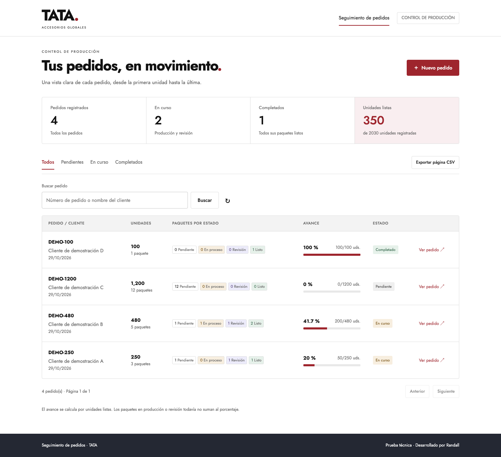
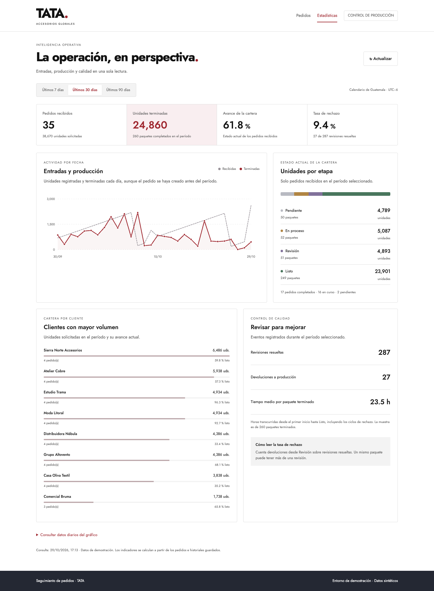

# Seguimiento de pedidos · TATA

Aplicación web para registrar pedidos, dividirlos en paquetes de hasta 100 unidades y dar seguimiento a su producción. Desarrollada con **Angular, Node.js, Express, MongoDB y TypeScript**, utilizando **SDD con apoyo de Codex**.

**Estado:** publicada y verificada con MongoDB Atlas.

- **Aplicación:** [seguimiento-pedidos-tata.onrender.com](https://seguimiento-pedidos-tata.onrender.com/)
- **Código público:** [RSGarcia2002/seguimiento-pedidos](https://github.com/RSGarcia2002/seguimiento-pedidos)
- **Correo preparado:** [borrador de entrega](docs/entrega.md).
- **Demostración:** [guía de presentación](docs/guia-presentacion.md).






## Funcionalidades

- Registro de pedidos con número único, cliente y cantidad entera positiva.
- División automática: 250 unidades generan paquetes de **100 + 100 + 50**.
- Flujo por paquete: **Pendiente → En proceso → Revisión → Listo**.
- Rechazo desde Revisión hacia En proceso, con motivo opcional e historial persistente.
- Conteos por estado y avance ponderado por **unidades listas**, no por número de paquetes.
- Búsqueda literal por número o cliente, filtros, paginación y resumen global de producción.
- [Estadísticas operativas](https://seguimiento-pedidos-tata.onrender.com/estadisticas) con períodos de 7, 30 y 90 días: entradas, producción, estados, clientes y calidad.
- Exportación CSV de la página visible, con protección contra fórmulas en campos de texto.
- Interfaz en español, adaptable a móvil y con navegación por teclado.
- Control de concurrencia para evitar dobles avances y transiciones sobre datos obsoletos.

## Ejecutar localmente

Requisitos: Node.js **24.15+ de la rama 24**, npm y Docker o MongoDB disponible.

```sh
git clone https://github.com/RSGarcia2002/seguimiento-pedidos.git
cd seguimiento-pedidos
npm ci
cp apps/api/.env.example apps/api/.env
```

Inicia MongoDB con volumen persistente:

```sh
docker compose up -d --wait
```

Si tu instalación no tiene Docker Compose, esta alternativa usa el mismo puerto de conexión:

```sh
docker run -d --name seguimiento-pedidos-mongo \
  --publish 127.0.0.1:27019:27017 \
  --volume seguimiento-pedidos-datos:/data/db mongo:8.0
```

En ejecuciones posteriores, si el contenedor ya existe: `docker start seguimiento-pedidos-mongo`.
La URI de ejemplo es `mongodb://127.0.0.1:27019/seguimiento_pedidos`.
Para usar otra base, cambia `MONGODB_URI` en `apps/api/.env`.
La instalación del autor ya utiliza Atlas mediante un archivo ignorado por Git; la URI de ejemplo continúa apuntando a Docker para que el proyecto sea reproducible sin compartir credenciales.

```sh
npm run dev
```

- Interfaz: [http://localhost:4200](http://localhost:4200).
- Salud de la API: [http://localhost:3000/api/salud](http://localhost:3000/api/salud).
- Angular redirige `/api` al backend durante el desarrollo.

Si solo tienes Node 25 global y no quieres cambiarlo, puedes anteponer a los comandos npm:

```sh
npm exec --yes --package=node@24 -- npm run dev
```

Los datos se conservan en el volumen de Docker. Detener o reiniciar el contenedor no los elimina.

## Datos de demostración

Con la API funcionando, ejecuta opcionalmente:

```sh
npm run datos:ejemplo
```

Crea cuatro pedidos `DEMO-*` mediante la API real, con distintos estados y avances. No modifica ejemplos existentes ni los carga automáticamente en producción. Todos los clientes de estos pedidos se identifican como demostración.


### Operación de demostración ampliada

```sh
npm run datos:operacion
```

Carga un lote de **96 pedidos sintéticos**, ocho clientes ficticios y 90 días de actividad.
Cada paquete mantiene cantidades, fechas, estados, versiones y rechazos coherentes.
El lote se identifica con `origenDatos=sintetico`; la interfaz indica que es un entorno de demostración.
La carga es aditiva: no reemplaza pedidos existentes y repetirla no agrega duplicados.
En Atlas quedó una muestra inicial de **100 pedidos**: 96 nuevos y los cuatro ejemplos anteriores.

Consulta [la descripción de los datos y métricas](docs/datos-demostracion.md) para reproducirla.
Las estadísticas se consultan desde MongoDB, no son valores fijos en la interfaz.

## Pruebas y compilación

Con MongoDB local disponible en el puerto 27019:

```sh
npm run typecheck
npm test
npm run build
npx playwright install chromium
npm run test:e2e
```

En macOS, puedes usar Chrome instalado sin descargar otro navegador:

```sh
PLAYWRIGHT_CHANNEL=chrome npm run test:e2e
```

- **Dominio:** partición, límites, entradas inválidas, avance por unidades y transiciones.
- **Integración real:** API y MongoDB; duplicados normalizados, condiciones de carrera, rechazos, motivos, búsquedas, filtros y persistencia tras reconectar.
- **Interfaz:** crea 250 unidades, rechaza y completa el paquete de 50, comprueba el 20% tras recargar, consulta historial, busca, exporta CSV y verifica un duplicado y anchos móviles.
- Las pruebas de integración usan una base con nombre aleatorio y eliminan exclusivamente esa base. `TEST_MONGODB_URI` permite indicar un servidor alternativo.
- Las pruebas de navegador usan `seguimiento_e2e`, un puerto API separado (3100) y borran el registro específico creado por la ejecución.
- La plantilla `docs/ci/verificacion-github.yml` reproduce las verificaciones con MongoDB 8 y Chromium. Para activarla, colócala en `.github/workflows/verificacion.yml` usando una credencial con permiso `workflow`.

## Arquitectura y decisiones

```text
Navegador → Angular → API Express → MongoDB
                        ↓
               reglas de dominio
```

Los pedidos guardan sus paquetes embebidos en un documento MongoDB. La creación es una sola inserción y el número tiene un índice único. Cada transición compara **estado y versión** del paquete dentro de una escritura atómica que guarda el nuevo estado y el historial. La versión impide reutilizar una solicitud antigua después de un ciclo de rechazo y revisión.

El porcentaje se deriva de las unidades de paquetes listos: un paquete de 50 completado en un pedido de 250 representa **20%**. No se guarda un porcentaje independiente que pueda quedar desactualizado.

- `apps/web`: interfaz Angular standalone, formularios y servicio HTTP.
- `apps/api`: API Express, dominio, modelos Mongoose y pruebas.
- `docs/spec.md`: especificación y criterios definidos antes de implementar.
- `docs/openapi.json`: contrato OpenAPI de las operaciones públicas.
- `docs/plan.md`: avance y verificaciones.
- `docs/agent-log.md`: decisiones, incidencias y correcciones del agente.
- `docs/diseno.md`: adaptación visual de [TATA Accesorios Globales](https://tataaccessories.org/es).

La tipografía Jost se sirve localmente. La marca textual es una aproximación tipográfica, no el archivo de logotipo original.

## API

| Método | Ruta | Función |
| --- | --- | --- |
| GET | `/api/estadisticas?dias=30` | Métricas de cartera, actividad y calidad |
| GET | `/api/salud` | Disponibilidad de API y conexión |
| GET | `/api/pedidos` | Listado, filtros y resumen global |
| POST | `/api/pedidos` | Crear pedido y paquetes |
| GET | `/api/pedidos/:id` | Detalle e historial |
| POST | `/api/pedidos/:id/paquetes/:paqueteId/transiciones` | Avanzar o rechazar |

Las transiciones reciben `accion`, `estadoActual`, `versionActual` y un `motivo` opcional. Un conflicto devuelve HTTP 409; los datos inválidos devuelven 400. El contrato completo, ejemplos y esquemas están en `docs/openapi.json`.

## SDD y uso de IA

Se siguió la secuencia **especificación → contrato → implementación → verificación**. Codex apoyó la preparación, programación, documentación y pruebas. Las decisiones y criterios están versionados en `docs/`.

### Error real del agente y corrección

Al configurar las fechas automáticas de Mongoose con nombres en español, la inferencia de TypeScript interpretó sus nombres como cadenas abiertas y generó una firma de índice incorrecta de tipo `Date`. La compilación falló al crear y presentar pedidos.

Se corrigió declarando los nombres de las fechas como literales con `as const`, sin quitar el tipado estricto ni introducir `any`. Después pasaron la compilación y las pruebas de integración con MongoDB real, incluidas creación, transiciones y reconexión. Más detalles en `docs/agent-log.md`.

## Publicación en Render

Una sola aplicación Node sirve `/api` y los archivos Angular compilados; no necesita CORS abierto ni una URL de API expuesta en el frontend.

| Configuración | Valor |
| --- | --- |
| Runtime | Node |
| Rama | `main` |
| Build | `npm ci --include=dev && npm run build` |
| Inicio | `node apps/api/dist/servidor.js` |
| Node | `NODE_VERSION=24` |
| Entorno | `NODE_ENV=production` |
| Conexión | `MONGODB_URI` como secreto con URI de Atlas |
| Salud | `/api/salud` |

Render proporciona `PORT`; el servidor escucha conexiones externas y cierra de forma ordenada ante SIGTERM. En Atlas deben autorizarse las direcciones de salida del servicio Render. La URI no se incluye en el repositorio ni en los logs.

## Alcance y límites

Esta es una aplicación de demostración para evaluación técnica, con datos de ejemplo y sin autenticación o separación por usuarios. No se implementan edición o eliminación de pedidos, para conservar la consistencia de cantidades e historial. Los extras incluyen historial, exportación, estadísticas, filtros y alertas con resumen por reglas. La integración opcional con Gemini está implementada y probada mediante simulación HTTP; no está activada ni verificada contra Google sin una clave.

Para mantener acotado el tamaño del documento, cada pedido admite hasta 100 000 unidades (1000 paquetes). Número: máximo 50 caracteres; cliente: 120; motivo: 300. El listado se pagina a 12 pedidos por defecto.

**Publicación verificada:** Render activo, API con respuesta HTTP 200 y Atlas conectado; creación 100/100/50, rechazo, avance 20%, persistencia tras recargar y duplicados comprobados desde internet. El listado y detalle se revisaron en escritorio y móvil, incluidos 320px, con estilos aplicados y sin errores de consola.

El plan gratuito de Render puede tardar aproximadamente un minuto al reactivarse después de inactividad. [Referencia de Render](https://render.com/docs/free).

**Mejora opcional pendiente:** La CI no está activada: la credencial de publicación carece del permiso `workflow`; la plantilla queda incluida para habilitarla.

## Convenciones

Código propio, comentarios y documentación en español. Se conservan los identificadores exigidos por frameworks, formatos y herramientas. Los comentarios explican intención, reglas y decisiones. No se publican archivos `.env`, credenciales ni datos de ejecución.

## Alertas y resumen operativo

Disponible en `/operacion`: revisiones detenidas, pedidos sin actividad y rechazos repetidos, con evidencia y enlaces. Funciona sin pagos ni claves mediante reglas explícitas. El listado permite filtros por cliente y fechas, y orden por avance o antigüedad. Consulta [criterios, IA opcional y pruebas](docs/operacion.md).
